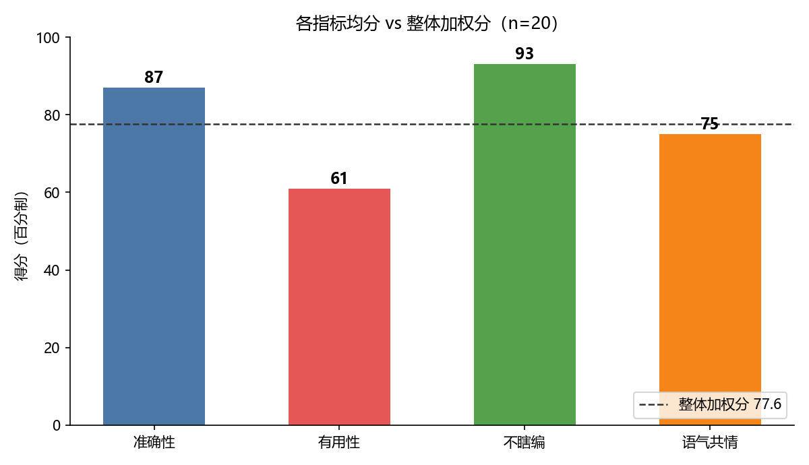
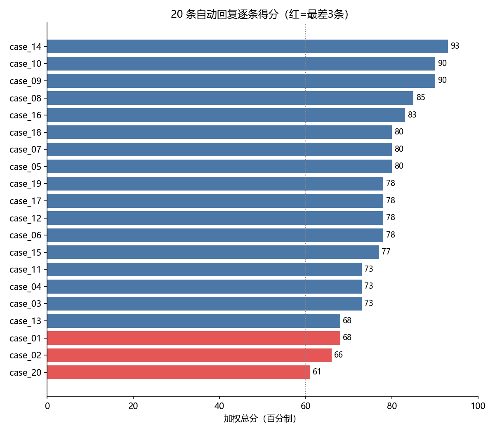
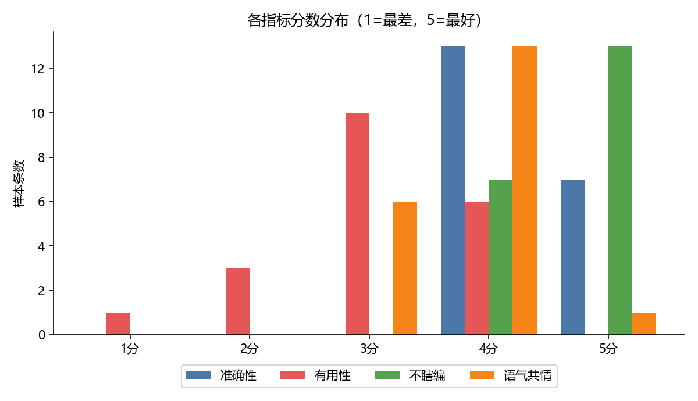

# 客服自动回复质量评估流水线

把业务方一句模糊的「回复要**准确、有用、语气好、不能瞎编**」落成一套可反复运行的评估流水线，对 20 条自动回复逐条打分并产出报告。

## 快速开始

```bash
# 离线可复现模式（默认，无需任何 API key）
python run.py mock

# 真实 LLM 裁判模式（需自配 OpenAI 兼容接口）
set OPENAI_API_KEY=sk-xxx
set OPENAI_BASE_URL=https://your-endpoint/v1
set JUDGE_MODEL=your-model
python run.py real
```

产物：
- `results/scores.json` — 20 条逐条分数字段
- `results/report.md` — 评估报告（总分 / 指标分布 / 最差 3 条 / 改进建议）
- `results/chart_*.png` — 可视化图表（`python make_charts.py` 生成，需 matplotlib）

核心流水线零第三方依赖，纯 Python 标准库，Python 3.8+ 即可跑；出图脚本另需 `pip install matplotlib`。

## 评估结果速览

整体加权分 **77.6 / 100**（20/20 及格，0 条触发"疑似编造"红线）。短板在**有用性**：







---

## 一、指标定义及理由

业务方四句话，映射为 4 个 1~5 分指标。权重体现优先级：**「不瞎编」是硬约束，「有用」是核心价值**。

| 指标 key | 业务原话 | 量化方式 | 权重 | 选择理由 |
|---|---|---|---|---|
| `accuracy` 准确性 | "准确" | 回复中事实/规则/时效类陈述是否正确，按 5/3/1 锚点打 1~5 | 0.25 | 说错规则会直接误导用户（如充电宝登机规则、退款时效），是底线之一 |
| `helpfulness` 有用性 | "有用" | 是否针对用户**这次的具体问题**给出可执行方案，或主动代查/代办理；而不是甩通用规则后让用户自己查 | 0.35 | 自动回复的存在意义就是解决问题。人工标注显示本批样本最大短板就在这里（均分仅 3.05） |
| `groundedness` 不瞎编 | "不能瞎编" | 是否避免对无法核实的具体事实（具体商品参数、订单状态、补偿额度）做武断断言 | 0.25 | 编造商品参数/订单信息会摧毁用户信任、有合规风险。**且设为硬门槛**：该指标=1 时总分封顶 40 并打红旗 |
| `tone` 语气与共情 | "语气好" | 是否礼貌、承接情绪；投诉/焦虑场景有无安抚、有无"加强培训"类内部话术 | 0.15 | 语气不直接决定对错，但在生气/恐慌场景下显著影响体验；权重最低 |

**为什么不直接用规则匹配打分？** "有没有用""语气好不好"是语义判断，关键词覆盖会误伤（比如"联系客服"在某些回复里是合理兜底）。所以最终分数由 **LLM-as-judge 按 rubric 打分**，规则特征（推卸自助短语数、共情词数、主动揽办数、是否反问澄清）只作为辅助信号和报告里的可解释依据。

**优先级结论**：不瞎编 ≈ 准确（安全底线，先于一切）> 有用（核心价值）> 语气。对应权重 0.25/0.25/0.35/0.15，另用 groundedness 封顶机制把"不瞎编"从加权项升级为硬门槛。

## 二、评估方法

流水线（`run.py` → `eval/pipeline.py`）：

1. **加载** `data/auto_replies.json`（20 条 用户问题+自动回复）与 `data/human_ref.json`（人工参考回复+标注）。
2. **规则特征抽取**（`heuristics.py`）：推卸自助短语数、共情词数、主动揽办词数、是否反问、用户是否带情绪。
3. **LLM-as-judge 打分**（`judge.py`）：
   - `mock` 模式：加载 `judge_fixtures/mock_verdicts.json`。这是开发时由裁判模型（Doubao）按上方 rubric 对 20 条样本逐条打出的分数+理由，固化为 fixture，**任何人克隆下来都能跑出完全一致的结果**，便于本地复现和 CI。
   - `real` 模式：把 用户问题/自动回复/规则特征/rubric 拼成 prompt，调 OpenAI 兼容 `/chat/completions`（temperature=0，JSON 输出），解析 4 个指标分数。换裁判模型即可横向对比。
4. **加权汇总**（`metrics.py:overall_score`）：加权和 ×20 转百分制；groundedness=1 时封顶 40。
5. **出报告**（`report.py`）：整体分、各指标均分与 1~5 分布、逐条表、最差 3 条（自动附上人工参考与标注备注做对照）、改进建议。

**与人工标注的对齐验证**：最差 3 条（case_20 答非所问、case_02 不查具体商品、case_01 推卸自助）与 `human_ref.json` 中标注者的批评方向完全一致；最高的 case_14（建议类反馈）也被人工评为"处理得不错"，说明评分排序和人工判断同方向。

## 三、局限性 & 哪些 case 可能评不准

1. **LLM 裁判本身有偏**：不同裁判模型对"3 分还是 4 分"没有完全一致的锚点，temperature=0 也只能降低随机性。上线前应拿这批 20 条做**裁判一致性校验**（多个裁判模型/多轮打分，算 Spearman 相关），并沉淀更多人工标注。
2. **"事实正确"缺乏外部知识源**：裁判只能基于常识判断，像 case_08 的"TPU 材质"、case_18 的"30 天质保"这类**企业私有政策/商品参数**，裁判无从核实——本批是靠 human_ref 才知道对错。生产环境必须接商品库/订单库/RAG，否则 accuracy 指标会虚高。
3. **对"分寸"判断不稳**：case_02 里"正确但没答到点上"（有用性低、但不瞎编高）这种张力，裁判可能在边界 case 上摇摆；mock fixture 固化了本次判断，换模型重跑可能变。
4. **样本只有 20 条、单一业务**：分布偏售前/售后常规问题，没覆盖多轮对话、辱骂、封号等高难场景；结论（约 78 分）不能直接外推到全量。
5. **权重是拍的**：0.25/0.35/0.25/0.15 是基于业务叙述的主观设定，建议后续用业务方更明确的"红线 case"来校准（比如编造化必须一票否决）。
6. **规则特征可被话术绕过**：把"联系客服"换成"由我们的专属团队为您跟进"，特征数下降但本质没变；所以特征只做展示，不直接计分。
7. **单轮评估**：现有数据只有一问一答，评不出"多轮上下文里是否记得前文""是否过度承诺"。

**改进方向**：接真实商品/订单知识库做 groundedness 事实核验；扩充人工标注到 100+ 条并做裁判一致性回测；把评分阈值（如有用性<3 即转人工）做成线上兜底策略；按业务线拆分指标权重。

## 四、AI 工具使用情况

- **设计与编码**：本项目由豆包（Doubao）辅助完成——指标拆解、rubric 设计、Python 流水线代码、mock 裁判 fixture、README 均在 AI 协助下编写，人工做了方向把关和分数复核。
- **裁判角色**：`mock` 模式下的 20 条打分为 Doubao 按 rubric 一次性给出（temperature=0 思路），并已与 `human_ref.json` 的人工标注做方向一致性核对。
- **未使用**：未调用付费第三方 LLM API；`real` 模式代码已备好但未实际跑。
- **可复现性**：所有结果来自仓库内数据与 fixture，无随机种子依赖，`python run.py mock` 任何时候输出一致。
